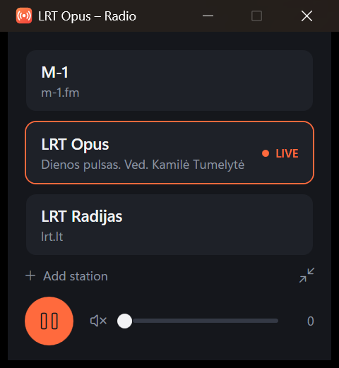
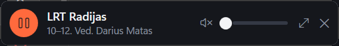

# Eteris

Eteris (Lithuanian for "the airwaves") is a tiny Windows app for listening to live internet
radio without opening a browser.
Pick a station, play or pause, set the volume — and it stays out of the way in the tray.



- **Always live.** Pressing play reopens the stream, so you hear the current broadcast,
  never the point where you paused.
- **Now playing.** Shows the current song or programme under the station name, in the tray
  tooltip and in the Windows media flyout (where the station provides it). Titles too long to
  fit scroll slowly instead of being cut off.
- **Lives in the tray.** Closing the window keeps the radio playing; the tray icon brings it
  back, switches station, or exits.
- **Mini player.** A one-line strip that stays on top of other windows.
- **Add stations in the app**, by searching a public directory or pasting a stream address.
- **Reconnects by itself** if the stream stalls or the network drops.
- **Remembers** the volume, the last station and where the windows were.
- **Media keys work**: play/pause, and next/previous to change station.
- No browser or extra player involved — it uses the media engine built into Windows.

Stations it ships with: M-1, LRT Opus, LRT Radijas.

## Install on a PC

Requires Windows 10 (version 2004) or Windows 11, 64-bit.

1. Open the [Releases](https://github.com/JuozapasN/Eteris/releases) page and download
   `Eteris-win-x64.zip` from the latest release.
2. Extract it to a folder you'll keep, e.g. `%LOCALAPPDATA%\Eteris`.
3. Run `RadioPlayer.exe`. Nothing else needs to be installed.

The exe is not code-signed, so the first run on a new PC may show a Windows SmartScreen
prompt — choose **More info → Run anyway**.

To get Desktop and Start menu shortcuts, either right-click the exe and pin it, or run
[install-shortcuts.ps1](install-shortcuts.ps1) from this repo:

```powershell
.\install-shortcuts.ps1 -Exe "$env:LOCALAPPDATA\Eteris\RadioPlayer.exe"
```

To update, exit the app (tray icon → **Exit**) and extract the new zip over the old folder.
Your stations and settings are kept separately and survive the update.

## Using it

| Action | Mouse | Keyboard |
| --- | --- | --- |
| Play a station | Click it | `1` – `9` |
| Play / pause | Round button, or click the playing station | `Space`, media play/pause key |
| Volume | Slider or mouse wheel | Arrow keys |
| Mute | Speaker icon | `M` |
| Next / previous station | | Media next / previous keys |
| Add a station | **Add station** under the list | |
| Reorder or remove a station | Right-click it | |
| Mini player | The arrows icon under the list | |
| Hide to the tray | Close the window | `Alt+F4` |

### Tray icon

The window's close button only hides it — the radio keeps playing. The icon in the notification
area (it may be behind the **^** arrow; drag it onto the taskbar to keep it visible):

- **Hover** — what's playing.
- **Left-click** — show or hide the player.
- **Right-click** — pick a station, play/pause, open the full window or the mini player, **Exit**.

### Mini player



A small strip that stays on top of other windows. Drag it anywhere; double-click it (or the
arrows button) for the full window; right-click it for the station list; **✕** hides it to the tray.
The app reopens in whichever mode you used last.

### Adding stations

**Add station** opens a dialog with two ways in:

- **Find a station** — type part of a name and press Enter. The search uses
  [radio-browser.info](https://www.radio-browser.info), a free community-run directory, so what
  you type is sent to that service. Only stations in formats Windows can play (MP3, AAC, HLS)
  are listed.
- **Enter a stream address** — the address of the audio stream itself (HLS `.m3u8`, or a direct
  MP3/AAC stream), not the station's web page.

### Command line

```powershell
RadioPlayer.exe --play 2            # start the second station in the list
RadioPlayer.exe --play "LRT Opus"   # start a station by name
RadioPlayer.exe --exit              # tell the running copy to exit (handy before updating)
```

Only one copy runs at a time; launching it again brings the open window to the front.

## Where things are stored

| File | What |
| --- | --- |
| `%APPDATA%\RadioPlayer\stations.json` | Your station list. Created the first time you add, remove or reorder a station. |
| `%APPDATA%\RadioPlayer\settings.json` | Volume, last station, window positions. |
| `stations.json` next to `RadioPlayer.exe` | The starting list, used until you have your own. |

The program file and its data folder keep the project's original name, `RadioPlayer`, so that
installs from before the rename to Eteris carry on working.

`stations.json` can also be edited by hand (exit the app first):

```json
[
  {
    "name": "LRT Opus",
    "note": "lrt.lt",
    "url": "https://stream-live.lrt.lt/radio_opus/lrt_opus.m3u8",
    "nowPlaying": "lrt:Opus"
  }
]
```

`nowPlaying` is optional and says where the "now playing" text comes from:

| Value | Meaning |
| --- | --- |
| *(absent)* | Direct MP3/AAC streams are asked for their own song title (ICY metadata). HLS streams show nothing. |
| `icy:<stream url>` | Read the song title from this Icecast/Shoutcast stream instead — for stations whose main stream is HLS but that also run a plain one. |
| `lrt:<channel>` | The programme currently on an LRT channel (`LR`, `Opus`, `Klasika`, `LRT100`), from LRT's programme guide. |

What you get depends on the station: music streams usually send artist and title, LRT gives the
programme name rather than individual songs, and some stations send nothing useful (M-1 only
sends its own name during talk shows, which is hidden).

## Building from source

Needs the [.NET 10 SDK](https://dotnet.microsoft.com/download).

```powershell
dotnet run --project src        # run it
.\build.ps1                     # portable build -> dist\Eteris-win-x64.zip
```

`build.ps1` produces a single self-contained `RadioPlayer.exe`, the same thing the release
contains. For a smaller build that relies on the .NET 10 Desktop Runtime being installed:

```powershell
dotnet publish src -c Release -o app
```

### Releasing

Push a version tag and GitHub Actions builds the zip and publishes the release
([release.yml](.github/workflows/release.yml)):

```powershell
git tag v1.2.0
git push origin v1.2.0
```

## Layout

| Path | What |
| --- | --- |
| `src/Radio.cs` | The player: station list, playback, reconnecting, volume. Every window is a view of it. |
| `src/NowPlaying.cs` | Reads the current song/programme (ICY stream metadata, LRT programme guide). |
| `src/StationDirectory.cs` | Station search against radio-browser.info. |
| `src/Station.cs`, `src/Settings.cs` | The station list and settings files. |
| `src/App.xaml(.cs)` | Startup, single instance, which window is showing; shared dark styles. |
| `src/MainWindow.*`, `src/MiniWindow.*`, `src/AddStationWindow.*` | The three windows. |
| `src/TrayIcon.cs`, `src/AppMenu.cs` | Tray icon and the right-click menu it shares with the mini player. |
| `build.ps1` | Portable build script. |
| `install-shortcuts.ps1` | Creates Desktop / Start menu shortcuts. |
| `tools/make-icon.ps1` | Regenerates `src/app.ico`. |
| `.github/workflows/release.yml` | Builds and publishes a release when a `v*` tag is pushed. |

## License

Copyright (C) 2026 JuozapasN

Eteris is free software: you can redistribute it and/or modify it under the terms of the
GNU General Public License as published by the Free Software Foundation, either version 3 of
the License, or (at your option) any later version.

Eteris is distributed in the hope that it will be useful, but WITHOUT ANY WARRANTY; without
even the implied warranty of MERCHANTABILITY or FITNESS FOR A PARTICULAR PURPOSE. See the
[GNU General Public License](LICENSE) for more details.

Eteris is not affiliated with or endorsed by the stations it lists. Station names belong to
their owners, and the streams remain theirs to change or withdraw.
